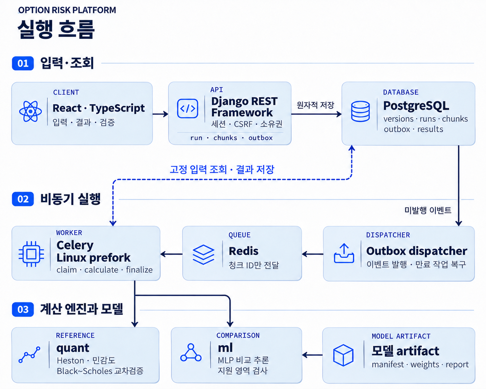

<div align="center">


# Option Risk Platform

**유럽형 옵션 포트폴리오의 가격·민감도·스트레스 손익을 계산하고 Heston과 ML 결과를 비교하는 금융 분석 시스템**


[핵심 설계](#핵심-설계) · [실행 화면](#실행-화면) · [ML 모델과 검증](#ml-모델과-검증) · [검증 결과](#검증-결과) · [로컬 실행](#로컬-실행)

</div>

## 핵심 설계

금융 계산, 모델 근사, 실행 복구를 분리해 검증합니다. `src/quant`와 `src/ml`은 Django·DB에 의존하지 않고,
Django API와 Celery worker가 같은 계산 패키지와 고정된 입력 버전을 사용합니다.

### 수치 계산과 금융 계약

| 구현 | 계산·검증 방식 |
| --- | --- |
| **Black–Scholes** | 유럽형 콜·풋 직접 구현. 독립 기준값과 QuantLib `AnalyticEuropeanEngine`, put-call parity, 가격 경계로 교차검증 |
| **Heston 기준 엔진** | QuantLib `AnalyticHestonEngine`, Gatheral 형식, Gauss–Laguerre 144점 적분. 192점과의 수렴·일정분산 및 평균회귀 분산 극한 검증 |
| **기본 민감도** | 기준 엔진의 중앙차분 재평가로 Delta·Gamma·초기 변동성 민감도 계산. spot 상대 bump `1e-4`, sigma0 절대 bump `1e-4`와 실제 사용값 기록 |
| **스트레스·집계** | 평가일과 잔존만기 고정. 부호 있는 수량 × 승수 × 단위 가격으로 포지션 가치를 구하고, 같은 모델의 stress − base로 P&L 계산 |

초기 변동성 **+5%p는 sigma0 +0.05**, 금리 **+100bp는 +0.01**, 현물 충격은 상대 %입니다.
Heston의 초기 분산은 `(sigma0 + delta_sigma0)²`로 갱신하며 잘못된 충격을 경계값으로 보정하지 않습니다.
가격 실패는 이유와 `null`로 남기고, 모든 필수 셀이 성공한 경우에만 총액과 P&L을 제공합니다.

검증 입력에서의 144점·192점 비교 허용오차는 `2e-8`입니다. 모든 입력에서의 정확도를 보장하는 수치는 아닙니다.
[금융 입력 계약](docs/financial-contracts.md)과 [수치 검증·허용오차](docs/numerical-validation.md)에 세부 기준을 정리했습니다.

### 불변 입력과 계산 출처

- 포지션·시장·시나리오·모델을 각각 버전으로 저장하고, 표준 JSON의 SHA-256을 기록합니다.
- 실행은 버전 ID와 해시, 평가일, 적분·bump 설정, 코드 해시, 라이브러리 버전, 모델 artifact를 고정합니다.
- 발행된 입력과 결과는 ORM·Admin에서 변경을 막고 PostgreSQL trigger로 UPDATE·DELETE를 제한합니다.
- 작업자는 입력·모델·코드·런타임을 다시 확인합니다. 과거 결과를 덮어쓰는 대신 같은 입력으로 새 실행을 만듭니다.
- 모델 파일은 manifest 해시별 경로에 보관하며, manifest·weights·validation report의 무결성을 확인합니다.

### 비동기 실행과 장애 복구

1. `POST /api/runs/`는 실행·시나리오별 청크·outbox를 **같은 DB 트랜잭션**에 저장한 뒤 HTTP **202**를 반환합니다.
2. Dispatcher가 미발행 이벤트를 읽어 **청크 ID만 Redis에 전달**합니다. HTTP 요청이나 DB 트랜잭션 안에서 가격을 계산하지 않습니다.
3. Linux prefork Celery worker가 청크를 claim하고 **300초 lease·attempt token**을 받습니다. 계산 후 현재 token과 lease를 재검증합니다.
4. `(run, scenario, position)` unique constraint와 원자적 결과 저장으로 중복 기록을 막습니다. 만료 작업을 재발행하고 이전 작업자의 늦은 저장은 거부합니다.

메시지 전달과 계산은 중복될 수 있습니다. 중복 처리·작업자 유실을 전제로 결과 저장을 제어하며,
실패한 청크와 완료된 청크를 구분합니다. [백엔드 설계](docs/backend-design.md)에 잠금 순서·복구 조건·소유권 검사를 설명했습니다.



## 실행 화면

### 포지션 구성

수동·CSV 입력으로 콜/풋, 롱/숏, 만기, 부호 있는 수량과 승수를 지정합니다.
저장한 버전을 다시 열거나 수정한 입력을 새 버전으로 보관합니다.


### 시장·시나리오

평가일·현물·금리·초기 변동성을 설정하고, 현물 %·변동성 %p·금리 bp 단위로 충격을 구성합니다.
고정 Heston 파라미터와 초기 분산을 확인한 뒤 기준 평가 또는 ML 비교를 실행합니다.


### 평가 결과·실행 이력

시나리오별 총액·스트레스 P&L, 손익 차트, 포지션별 가격과 기본 민감도를 확인합니다.
시나리오가 8개 이하면 막대그래프, 그보다 많으면 히트맵으로 비교합니다.
불완전한 결과와 ML 미지원 사유를 구분하며 계산 출처를 포함한 CSV·JSON을 내려받습니다.


### 모델 검증

등록된 모델 버전을 선택해 지원 영역, 검증 표본별 오차, 포트폴리오 P&L 오차와 실행 시간을 확인합니다.
선택한 모델을 같은 입력의 COMPARE 실행에 사용할 수 있습니다.


## ML 모델과 검증

**기준 가격과 민감도는 Heston 엔진이 담당하고, MLP는 비교용 근사 모델로 사용합니다.**
지원 영역 밖 입력, 다른 고정 모델 사양, 유효하지 않은 출력은 사유와 함께 거부하고 reference 결과를 보존합니다.

### 학습 구조

| 항목 | 구성 |
| --- | --- |
| 입력 4개 | `log(S/K)`, ACT/365F 잔존만기 `T`, 연속복리 연율 `r`, 초기 변동성 `sigma0` |
| 신경망 | `4 → 96 → 96 → 64 → 1`, SiLU, CPU float32 |
| 출력 | 콜 가격 `C/K`; 가격 상·하한을 출력 구조에 반영하고 풋은 put-call parity로 계산 |
| Teacher | Heston `AnalyticHestonEngine` 144점, float64 가격 |
| 학습 | 유효 학습 표본 15,977개, AdamW, 350 epochs, batch 512, seed 1729 |
| 모델 사양 | `kappa=2`, `theta=0.04`, `xi=0.3`, `rho=-0.7`, `q=0` 고정 |
| 추적 정보 | feature 순서·전처리·지원 영역·seed·dtype/device·소프트웨어 버전·데이터 및 가중치 해시 |

학습에서 제외한 연속 파라미터 영역과 만기·moneyness·변동성 경계도 별도로 검사했습니다.
Teacher 실패 입력과 사유는 보존하며 실패한 label을 0으로 만들지 않습니다.

### 가격 오차

**오차는 `|ML − reference| / K`**로,
옵션 가격 대비 상대오차가 아니며 reference 계산이 성공한 유효 표본만 집계합니다.

| 검증 집합 | 표본 수 | 평균 절대오차 | p99 | 최대 절대오차 |
| --- | ---: | ---: | ---: | ---: |
| 무작위 표본 | 1,593 | 0.00046088 | 0.00258371 | 0.00373852 |
| 학습에서 제외한 영역 | 1,600 | 0.00038016 | 0.00081464 | 0.00153840 |
| 지원 영역 경계 | 1,577 | 0.00073909 | 0.00482802 | 0.00751943 |
| **전체** | **4,770** | **0.00052578** | **0.00373638** | **0.00751943** |

행사가가 $100이면 평균 절대 가격 오차는 약 $0.05258, 최대는 $0.75194입니다. 짧은 만기에서 오차가 더 컸습니다.
40개 포트폴리오의 스트레스 P&L 절대오차는 평균 $28.49, 최대 $72.89였습니다.

### 동일 workload의 실행 시간

동일 512개 콜 입력, CPU 1 thread, 양쪽 warm-up 후 5회 중앙값입니다.

| 경로 | 512건 시간 |
| --- | ---: |
| 모델·엔진을 재사용한 QuantLib reference | 45.276 ms |
| ML 배치 + 입력·출력 검증 | 1.717 ms |
| ML 개별 호출 + 입력·출력 검증 | 64.144 ms |

**현재 worker는 개별 셀 호출 경로를 사용합니다.** 배치의 측정값을 실제 실행 속도 향상으로 해석하지 않으며,
개별 ML 호출은 이 측정에서 reference보다 느렸습니다. API·큐·DB·최초 artifact 로딩 시간은 위 표에 포함하지 않습니다.

새 데모 모델을 만드는 bootstrap과 CI는 비교용 품질 gate를 검사합니다. Gate는 baseline 관측 후 정한 수용 기준이며,
통과가 기준 엔진의 대체나 실제 위험관리 적합성을 의미하지 않습니다. [ML 검증 보고서](docs/ml-validation.md)에 조건·한계·재현 명령이 있습니다.

## 기술 스택

| 영역 | 사용 기술 |
| --- | --- |
| 웹 | React 19 · TypeScript · Vite · TanStack Query · Plotly |
| API·영속성 | Python 3.12 · Django 5.2 LTS · DRF · Django ORM/migrations · PostgreSQL |
| 금융 계산 | NumPy · SciPy · QuantLib |
| 작업 실행 | Celery · Redis · Linux prefork worker · durable outbox |
| ML | PyTorch CPU · 학습/평가 CLI · 해시 기반 artifact 보관 |
| 검증·실행 환경 | pytest-django · Hypothesis · Vitest · Playwright · Docker Compose · GitHub Actions |

## 검증 결과

[GitHub Actions 전체 검증](https://github.com/limbj/option-risk-platform/actions/runs/42397207266)이 통과했습니다.
수치 계산, ML 근사 품질, API·DB·복구, 브라우저 흐름은 서로 다른 검사로 확인합니다.

| 검사 | 확인 결과 |
| --- | --- |
| 전체 pytest · host / Linux | 각각 **443 passed**, PostgreSQL 전용 4개는 별도 검사 |
| PostgreSQL · host / Linux | 각각 **66 passed** — 소유권·CSRF·불변성·동시성·lease 복구 |
| 프런트엔드 | 단위 테스트 **7 passed**, TypeScript·Vite build 통과 |
| Playwright | 입력·평가·비교·다운로드·모델 선택, **1440/1024/390px** 화면과 키보드 탐색 |
| 실제 HTTP·Redis·worker | **19개 검사·6개 실행** 통과, dispatcher 중단 후 outbox 재개 |
| 실제 worker 강제 종료 | SIGKILL 후 lease 만료를 거쳐 **10,000개 결과·100개 총계** 복구, 중복 **0건** |

Worker 강제 종료 시험은 DB 시각을 조작하지 않고 기본 300초 lease를 기다렸으며 309.1초에 복구를 확인했습니다.
[CI 검증](docs/ci-validation.md)과 [서비스 통합·복구 검증](docs/stack-validation.md)에 환경과 확인 항목이 있습니다.

## 프로젝트 구조

```text
option-risk-platform/
├─ src/
│  ├─ config/              # Django 설정·URL·ASGI/WSGI·Celery
│  ├─ apps/                # accounts, portfolios, marketdata, valuations, model_registry
│  ├─ quant/               # 금융 계약·BS·Heston·민감도·스트레스·집계
│  └─ ml/                  # 데이터 생성·학습·검증·추론
├─ frontend/               # React 화면·차트·CSV 입력·브라우저 테스트
├─ tests/                  # 금융·ML·Django·동시성·복구 검증
├─ scripts/                # 로컬 bootstrap·실제 stack/worker 복구 검사
├─ examples/               # 합성 입력
├─ docs/                   # 계산 규칙·설계·검증 보고서·실행 화면
├─ compose.yaml            # API·DB·Redis·worker·dispatcher·web
└─ uv.lock                 # Python 의존성 고정
```

## 로컬 실행

Docker Desktop의 **Linux 엔진**, Python, **uv 0.13.7**을 준비한 뒤 저장소 루트에서 실행합니다.
애플리케이션용 Python 3.12는 uv가 관리합니다.

```powershell
python scripts/bootstrap_demo.py
```

초기 실행은 비밀키 생성, DB/migration, 데모 입력, ML 학습·검증, 이미지 빌드와 서비스 시작을 포함합니다.
**[http://127.0.0.1:5173](http://127.0.0.1:5173)**에서 계정 생성·비밀번호 입력 없이 로컬 작업공간으로 진입합니다.

<details>
<summary>Windows에서 uv가 없는 경우</summary>

```powershell
python -m venv work/bootstrap
.\work\bootstrap\Scripts\python.exe -m pip install uv==0.13.7
python scripts/bootstrap_demo.py
```

bootstrap이 저장소의 uv를 찾아 사용합니다. `.env`, DB, 데이터셋, 가중치는 Git에 포함하지 않습니다.

</details>

```powershell
docker compose stop
# 데이터와 실행 이력을 유지한 채 다시 시작
docker compose up -d db redis api worker dispatcher web
```

지원 범위는 **합성 지수 하나 · USD · 무배당(q=0) 유럽형 현금결제 콜/풋 · ACT/365F**입니다.
위험중립 모형 평가와 결정론적 스트레스 분석이며 VaR·ES·확률 예측을 제공하지 않습니다. 외부 배포·인터넷 공개는 하지 않습니다.

## 상세 문서

- [금융 입력 계약](docs/financial-contracts.md) · [수치 계산 검증](docs/numerical-validation.md)
- [백엔드 실행·복구 설계](docs/backend-design.md) · [ML 학습·검증 보고서](docs/ml-validation.md)
- [서비스 통합·복구 검증](docs/stack-validation.md) · [CI 검증](docs/ci-validation.md)
- [개발·테스트 명령](docs/development.md) · [로컬 운영 가이드](docs/local-operations.md)
