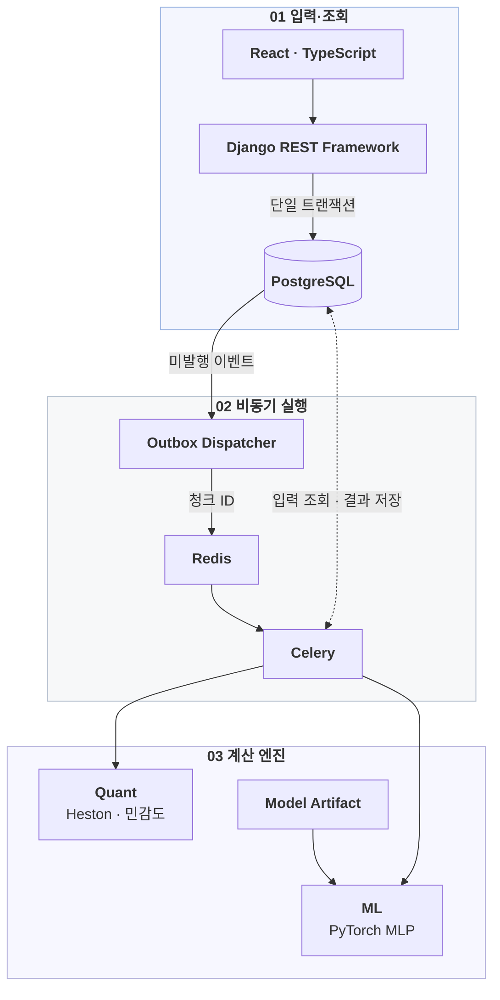
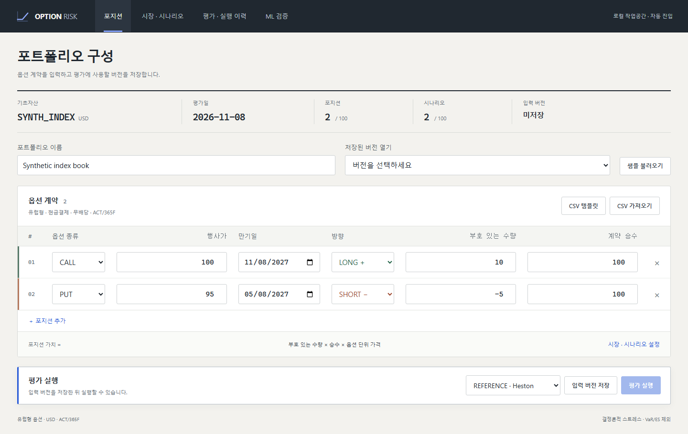
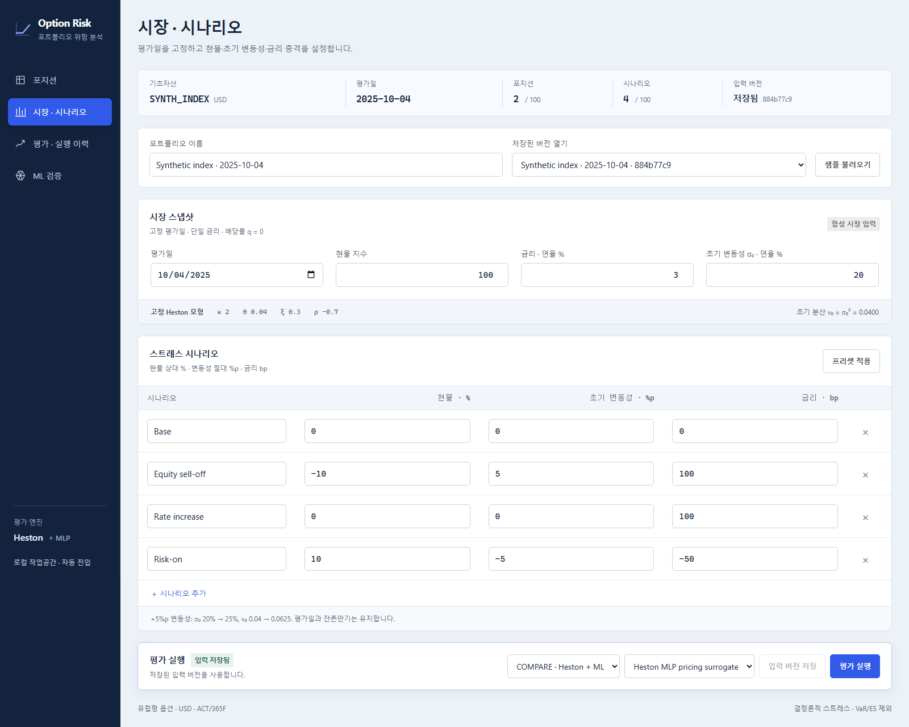
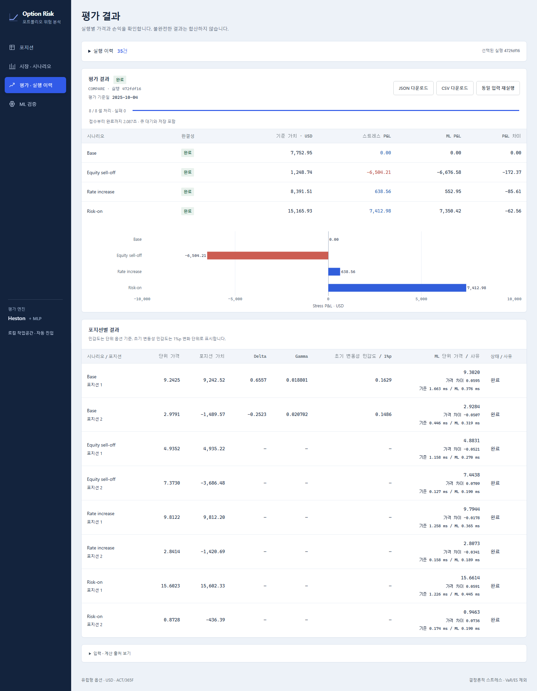
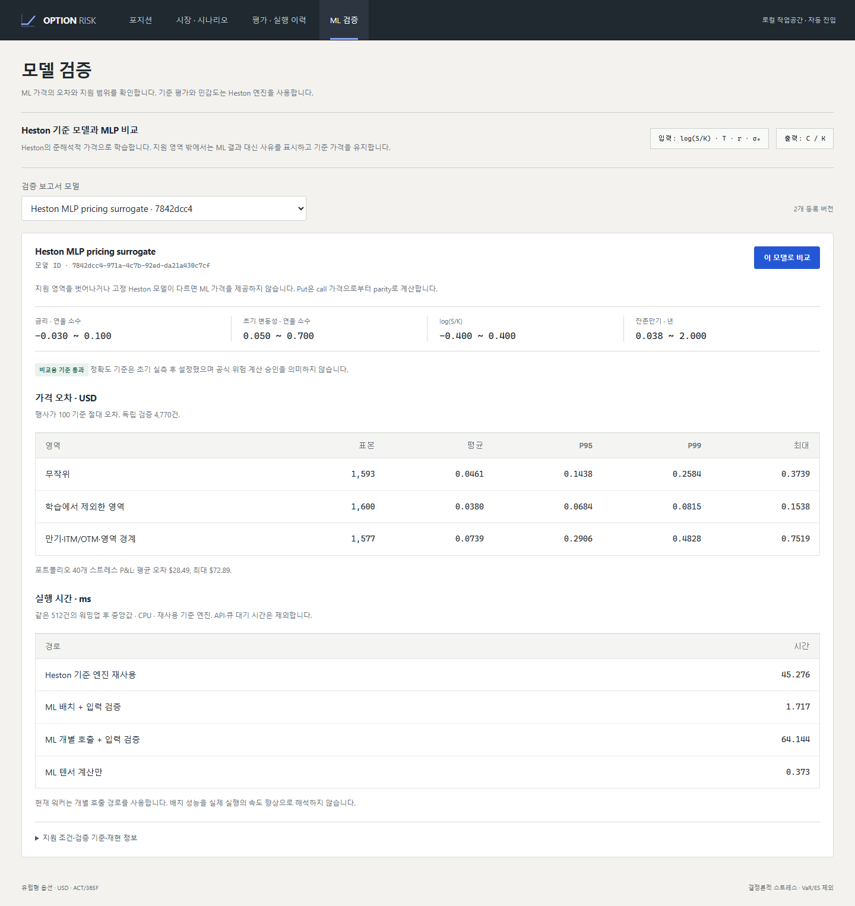

<div align="center">


# Option Risk Platform

**유럽형 옵션 포트폴리오의 가격·민감도·스트레스 손익을 계산하고 Heston과 ML 결과를 비교하는 금융 분석 시스템**


[핵심 설계](#핵심-설계) · [실행 흐름](#실행-흐름) · [실행 화면](#실행-화면) · [기술 스택](#기술-스택) · [로컬 실행](#로컬-실행)

</div>

## 핵심 설계

금융 계산과 ML을 Django·DB에 의존하지 않는 패키지로 분리하고, API와 워커가 같은 입력 버전과 계산 코드를 사용합니다.

<table>
  <thead>
    <tr><th width="120">핵심</th><th>구현</th></tr>
  </thead>
  <tbody>
    <tr>
      <td><strong>금융 계산</strong></td>
      <td>QuantLib 기반 Heston 가격 평가·중앙차분 민감도·스트레스 손익 계산. Black–Scholes 직접 구현 및 교차 검증</td>
    </tr>
    <tr>
      <td><strong>재현성</strong></td>
      <td>입력 버전·SHA-256 해시·수치 설정·모델 파일을 고정하고 실행별 계산 출처 기록</td>
    </tr>
    <tr>
      <td><strong>작업 복구</strong></td>
      <td>실행·청크·outbox를 단일 트랜잭션으로 저장. 워커의 lease·attempt token과 결과 저장 제약으로 만료 작업 복구·중복 기록 방지</td>
    </tr>
    <tr>
      <td><strong>ML 비교</strong></td>
      <td>PyTorch CPU MLP <code>4 → 96 → 96 → 64 → 1</code>로 Heston 가격 근사. 비교 전용이며 지원 범위 밖 입력은 거부</td>
    </tr>
  </tbody>
</table>

## 실행 흐름



## 실행 화면

### 포지션 구성

콜·풋 포지션을 직접 입력하거나 CSV로 가져오고, 입력을 버전별로 저장합니다.



### 시장·시나리오

시장 조건과 현물·변동성·금리 충격을 설정해 기준 평가 또는 ML 비교를 실행합니다.



### 평가 결과·실행 이력

시나리오별 손익과 포지션별 가격·민감도를 비교하고, 계산 출처를 포함한 CSV·JSON을 내려받습니다.



### 모델 검증

모델별 지원 범위·가격 오차·손익 오차·실행 시간을 확인하고 비교할 모델을 선택합니다.



## 기술 스택

| 영역 | 사용 기술 |
| --- | --- |
| 웹 | React · TypeScript · Vite · TanStack Query · Plotly |
| API·DB | Django REST Framework · PostgreSQL |
| 금융 계산·ML | NumPy · SciPy · QuantLib · PyTorch CPU |
| 비동기 실행 | Celery · Redis |
| 테스트·실행 환경 | pytest · Hypothesis · Vitest · Playwright · Docker Compose · GitHub Actions |

수치 계산·ML 오차·API·DB 동시성·작업 복구·화면 동작을 각각 검증합니다.
세부 결과는 [수치 검증](docs/numerical-validation.md), [ML 검증](docs/ml-validation.md), [CI 검증](docs/ci-validation.md), [서비스 복구 검증](docs/stack-validation.md)에 정리했습니다.

## 로컬 실행

Docker Desktop의 **Linux 컨테이너 모드**, Python, **uv 0.13.7**을 준비하고 저장소 루트에서 실행합니다.
애플리케이션용 Python 3.12는 uv가 관리합니다.

```powershell
python scripts/bootstrap_demo.py
```

DB·데모 입력·ML 모델·서비스가 자동으로 준비됩니다.
**[http://127.0.0.1:5173](http://127.0.0.1:5173)**에서 별도 로그인 없이 사용할 수 있습니다.

<details>
<summary>Windows에서 uv가 없는 경우</summary>

```powershell
python -m venv work/bootstrap
.\work\bootstrap\Scripts\python.exe -m pip install uv==0.13.7
python scripts/bootstrap_demo.py
```

</details>

지원 대상은 단일 합성 지수의 USD 표시 유럽형 콜·풋이며, 무배당·현금결제를 가정합니다.

## 상세 문서

[금융 입력 계약](docs/financial-contracts.md) · [백엔드 설계](docs/backend-design.md) · [개발·테스트](docs/development.md) · [로컬 운영](docs/local-operations.md)
